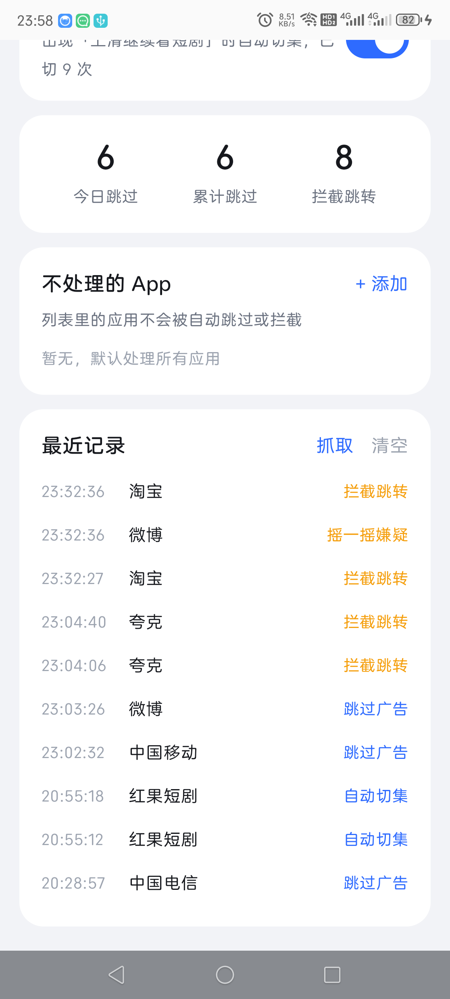
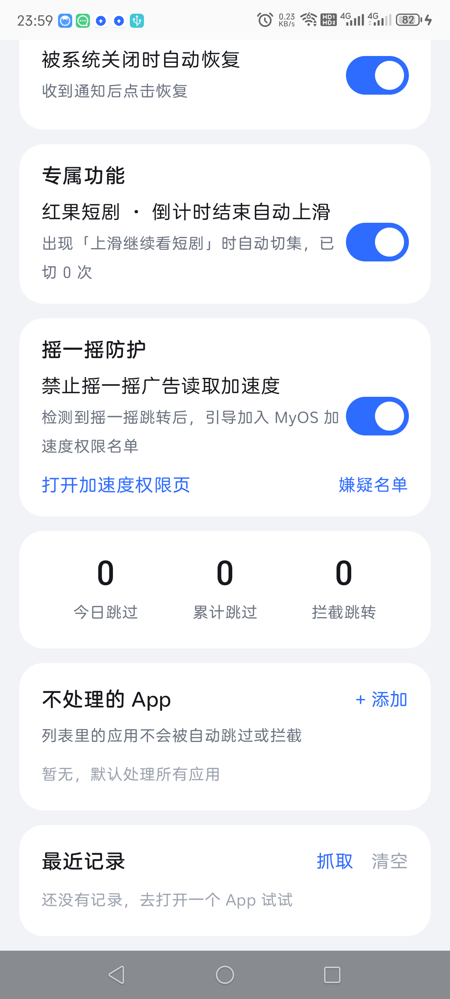
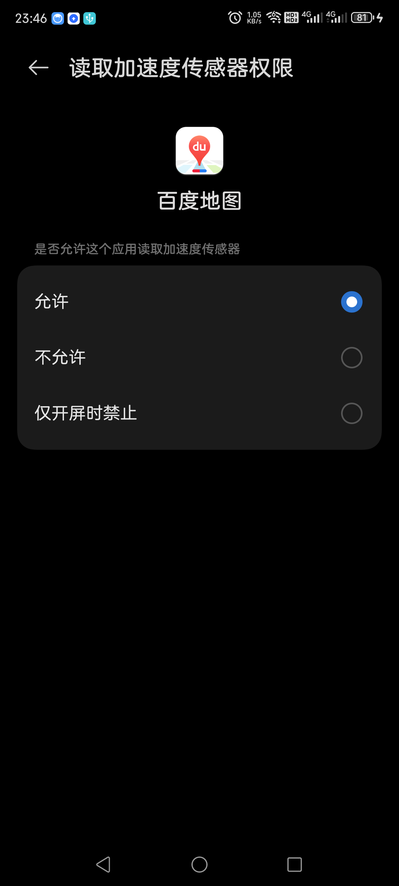

# 秒跳 · MiaoTiao

基于 Android 无障碍服务的开屏广告自动跳过工具，同时处理「摇一摇广告」。

不 root、不联网、不上传数据。

## 三个版本

| 版本 | 包名 | 说明 |
|---|---|---|
| **普通手机版** | `com.miaotiao.adskip` | 自动跳过开屏广告、拦截摇一摇跳转、操作振动、被系统关闭时自动恢复、红果短剧自动切集。**不含摇一摇防护** |
| **平板版** | `com.miaotiao.adskip.pad` | 功能与手机版一致，界面按大屏适配 |
| **Z50U 专用版** | `com.miaotiao.adskip.z50u` | 手机版全部功能 + **摇一摇防护**（MyOS 加速度权限检测与自动导航） |

> Z50U 专用版依赖努比亚 MyOS 的「读取加速度传感器」特殊权限页面，其他系统没有该页面，请用普通手机版。

## 截图

| 普通手机版 | Z50U 专用版 |
|---|---|
|  |  |

| Z50U 版：自动导航到加速度权限页 |
|---|
|  |

## 功能

### 通用（手机版 / 平板版）

- **开屏广告自动跳过**：识别「跳过 / 关闭广告 / 跳过广告」等按钮并点击；纯图片或 Canvas 渲染的广告用 ML Kit 中文 OCR 兜底
- **摇一摇跳转拦截**：广告把页面摇到浏览器或商城时，自动返回原 App
- **操作时轻微振动**
- **被系统关闭时自动恢复**：无障碍服务被杀后自动重新绑定（需要 `WRITE_SECURE_SETTINGS`，见安装）
- **红果短剧自动切集**：倒计时结束、出现「上滑继续看短剧」时自动上滑到下一集
- **不处理的 App**：名单内的 App 不会被跳过或拦截
- **使用统计与最近记录**

### Z50U 专用版额外

- **摇一摇防护**：
  - 开屏窗口内采样加速度，结合「跳转浏览器/商城 + 跳转前无点击 + 24 小时内重复」判断摇一摇广告
  - 命中后进入嫌疑名单，第二次命中发通知
  - 「去禁用」自动导航到 MyOS 的「读取加速度传感器」页面，由用户自己选择「允许 / 不允许 / 仅开屏时禁止」
  - 推荐选「仅开屏时禁止」：只拦启动时的摇一摇，不影响游戏、导航等正常使用

## 安装

1. 从 Releases 页面下载对应版本的 APK：
   - 普通手机：`miaotiao-0.2-phone.apk`
   - 平板：`miaotiao-0.2-pad.apk`
   - Z50U：`miaotiao-0.2-z50u.apk`
2. 安装（允许「未知来源」）
3. 打开秒跳 → 点「无障碍设置」→ 开启「秒跳 · 自动跳过」
4. 允许通知权限（Z50U 版用于摇一摇提醒）
5. 可选：自动恢复功能需要 adb 授权一次：

```bash
# 普通手机版
adb shell pm grant com.miaotiao.adskip android.permission.WRITE_SECURE_SETTINGS
# 平板版
adb shell pm grant com.miaotiao.adskip.pad android.permission.WRITE_SECURE_SETTINGS
# Z50U 版
adb shell pm grant com.miaotiao.adskip.z50u android.permission.WRITE_SECURE_SETTINGS
```

## 使用

- 首页四个开关分别控制：自动跳过、拦截摇一摇跳转、操作振动、被关闭时自动恢复
- 「专属功能」里是红果短剧自动切集
- Z50U 版首页多一张「摇一摇防护」卡（普通版/平板版没有这张卡）
- 「不处理的 App」里可以放行游戏、导航等不想被处理的应用
- 「最近记录」查看每次跳过、拦截、自动切集、摇一摇嫌疑

### 摇一摇防护怎么用（Z50U 版）

1. 打开带摇一摇广告的 App（例如微博）
2. 开屏广告出现时晃一下手机
3. 如果它跳到淘宝、京东或浏览器，秒跳会拦截并记录
4. 回到秒跳 → 摇一摇防护 → **嫌疑名单**
5. 点「去禁用」→ 秒跳自动打开该 App 的加速度权限页 → 自己选择「仅开屏时禁止」

## 工作原理

- `AccessibilityService` 监听窗口状态、滚动、点击事件
- 节点扫描找「跳过/关闭」按钮；找不到时用中文 OCR 识别
- 跳转拦截：普通 App → 浏览器/商城，8 秒内发生，商城跳转还要求跳转前无点击
- 摇一摇检测：开屏 10 秒窗口内 50Hz 采样加速度，计算峰值、方差、方向反转次数；结合跳转、点击、重复性打分
- 只在本机运行，无网络请求

## 限制

- WebView 内部的广告不会产生包名跳转，识别不到
- 摇一摇防护仅 Z50U / MyOS 可用；其他系统只能靠「拦截跳转」缓解
- APK 只包含 arm64-v8a（Z50U、小新 Pad 均为 arm64）；32 位设备需修改 `app/build.gradle.kts` 的 `abiFilters` 后重新构建
- 部分 ROM 需要关闭电池优化、允许自启动，否则无障碍会被杀
- 免 root，不修改系统设置（自动恢复需要一次性 adb 授权）

## 隐私

- 应用不申请网络权限，不收集、不上传任何数据
- 统计数据、记录、日志全部保存在本机应用私有目录

## 构建

需要 JDK 17、Android SDK 34、Gradle 8.6：

```bash
gradle assemblePhoneDebug assemblePadDebug assembleZ50uDebug
```

输出：

```
app/build/outputs/apk/phone/debug/app-phone-debug.apk
app/build/outputs/apk/pad/debug/app-pad-debug.apk
app/build/outputs/apk/z50u/debug/app-z50u-debug.apk
```

## 目录

```
android/           Android 工程（Kotlin + Compose）
docs/              产品与功能设计文档
releases/          发布说明与校验值
tools/             测试页面等辅助工具
```

## License

MIT
